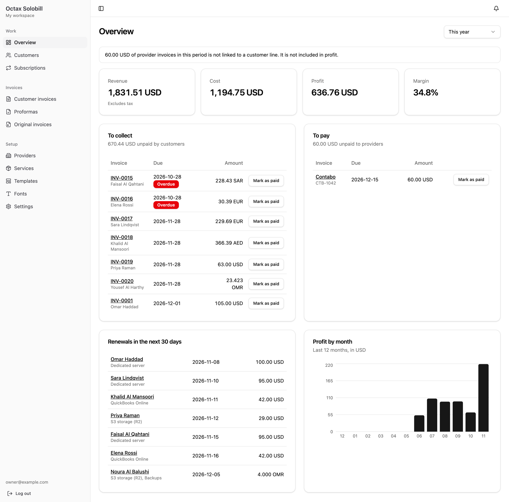
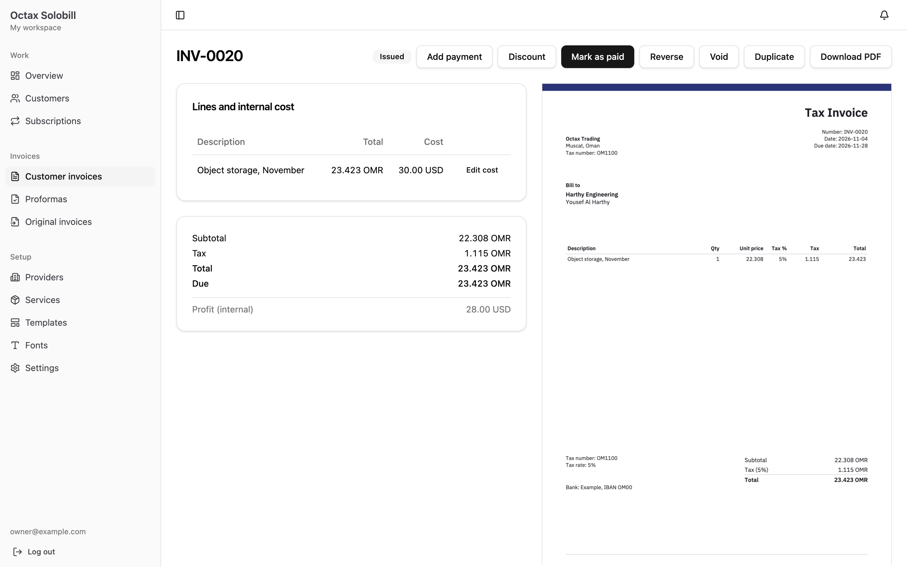
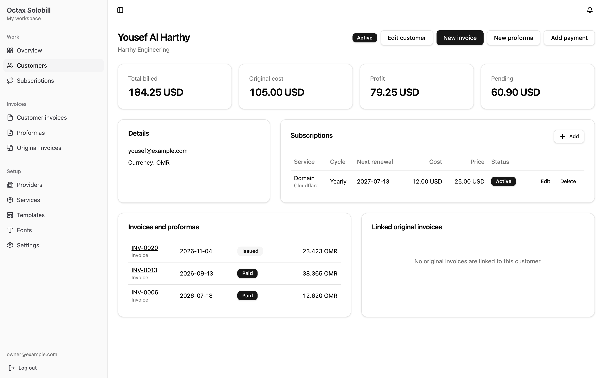
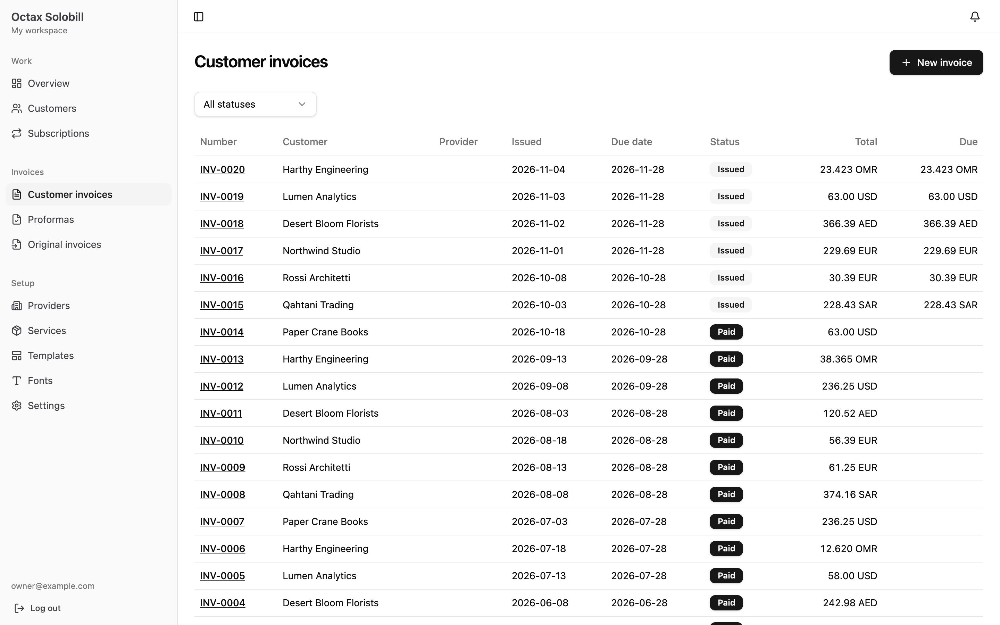
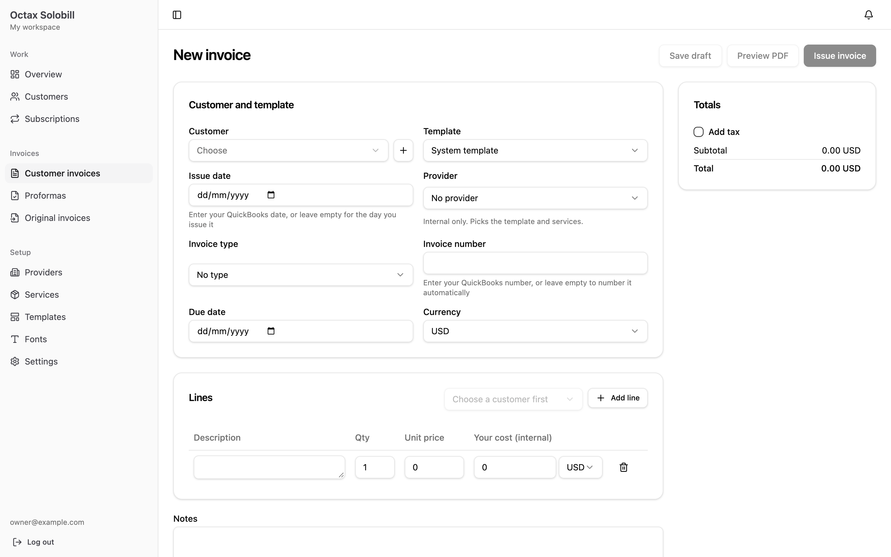
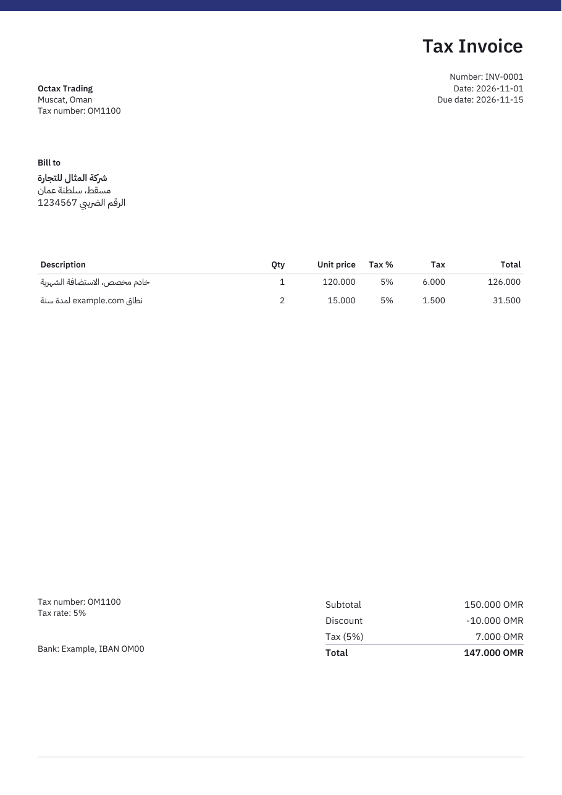

<p align="center"></p>

<h1 align="center">Octax Solobill</h1>

<p align="center">
  <strong>Billing for solo traders who resell services.</strong><br>
  Track what each service costs you and what you charge for it, issue invoices in your own layout,
  and see the profit in between.
</p>

<p align="center">
  <a href="https://inv.octax.dev"><strong>Use it free at inv.octax.dev</strong></a>
  ·
  <a href="docs/SELF_HOSTING.md">Self-host it</a>
  ·
  <a href="https://github.com/octax-app/solobill-ios">iOS app</a>
</p>

<p align="center">
  <a href="https://github.com/octax-app/solobill/actions/workflows/ci.yml"></a>
  <a href="https://github.com/octax-app/solobill/pkgs/container/solobill"></a>
  <a href="LICENSE"></a>
</p>

<p align="center">
  
</p>

## Who it's for

You're a developer, designer or consultant who also resells things to clients: hosting, domains,
cloud storage, software licences, app store accounts. Each one has a cost from the provider and a
price for the client, often in different currencies, and many renew every month or year.

Solobill keeps that in one place. It is **not** an accounting system. Keep using QuickBooks, Xero or
your accountant for the books. Solobill handles the day-to-day: what to bill, what's unpaid, what
renews next, and how much you actually made.

## Free hosted version

**[inv.octax.dev](https://inv.octax.dev) is free for everyone.** Sign up with email, Google or Apple
and you get your own private workspace. There's nothing to install, and it works with the
[iOS app](https://github.com/octax-app/solobill-ios).

Prefer to run it yourself? It's one Docker container. See [Self-hosting](#self-hosting).

## Features

**Know your margins**
- Providers, services and the subscriptions each customer has, with cost and price per line
- Provider bills ("original invoices") linked to the customer lines they pay for
- Revenue, cost, profit and margin for any period, all excluding tax, in your base currency
- Profit per customer and per month

**Bill clients properly**
- Customer invoices and proformas, with tax, discounts and partial payments
- Any currency, with exchange rates and the right decimals per currency (3 for OMR, KWD and BHD)
- Automatic numbering per issuing company, or type the number to match your accounting software
- Issued invoices are locked. Correct them by voiding and reissuing, or send an unpaid one back to
  draft
- Cost, profit and provider names never appear on anything the customer sees

**Your invoice, your layout**
- A clean built-in template, or upload your own PDF design and map the fields onto it
- Your own fonts, colours, logo and company details
- Arabic and other right-to-left text, shaped correctly, in the same document as English

**Stay on top of renewals**
- Renewal dates calculated from each subscription's start and cycle
- Draft invoices created ahead of each renewal, and reminders for unpaid bills
- Push notifications to the iOS app

**Built to be trusted with client data**
- Workspaces fully isolated from each other, enforced by tests on every route
- Sign in with email, Google or Apple, with optional two-step login
- Files only reachable through signed-in routes, never public URLs
- Nightly database backups, with off-site copies to any S3-compatible bucket
- A documented REST API ([`openapi.json`](openapi.json)) that the iOS app also uses

## Screenshots

<table>
  <tr>
    <td width="50%"></td>
    <td width="50%"></td>
  </tr>
  <tr>
    <td><b>Invoice.</b> Internal cost and profit on the left, exactly what the customer gets on the right.</td>
    <td><b>Customer.</b> What they've been billed, what it cost you, and what renews next.</td>
  </tr>
  <tr>
    <td></td>
    <td></td>
  </tr>
  <tr>
    <td><b>Invoices.</b> Every currency side by side, with what's still due.</td>
    <td><b>Editor.</b> Pull lines from subscriptions, or type your own.</td>
  </tr>
</table>

<p align="center">
  <br>
  <em>A generated PDF, mixing Arabic and English, with the discount applied before tax.</em>
</p>

## Self-hosting

```sh
git clone https://github.com/octax-app/solobill.git && cd solobill
cp .env.example .env.production     # set APP_URL=https://your-domain
docker compose up -d                # pulls ghcr.io/octax-app/solobill
docker compose exec web node src/server/scripts/admin.ts you@example.com 'a-long-password'
```

Put an HTTPS reverse proxy in front of `127.0.0.1:3000`. The
[self-hosting guide](docs/SELF_HOSTING.md) covers Traefik, Cloudflare, file storage, email, Google
and Apple sign-in, backups and updates.

Images are built for `linux/amd64` and `linux/arm64`.

## Development

You need Node 26 and pnpm. The PDF tests also need Poppler (`brew install poppler` or
`apt install poppler-utils`).

```sh
pnpm install
pnpm admin owner@example.com demo-password   # create an account
pnpm dev                                     # API on :3000, app on http://localhost:5173
pnpm demo                                    # optional: fill it with sample data
```

| Command | What it does |
|---|---|
| `pnpm test` | Runs all tests |
| `pnpm lint` / `pnpm lint:fix` | Checks lint and formatting, or fixes what it can |
| `pnpm typecheck` | Checks types |
| `pnpm build` | Checks types and builds the app into `dist/` |
| `pnpm db:generate` | Creates a migration after changing `src/server/db/schema.ts` |
| `pnpm openapi` | Regenerates `openapi.json` after changing the API response types |
| `pnpm backup` / `pnpm restore [file]` | Backs up or restores the database |

Settings live in `.env`. Copy [`.env.example`](.env.example) to start. Everything is optional in
development.

**Stack:** TypeScript, Hono, SQLite with Drizzle, React 19 with Vite and shadcn/ui, and
`@cantoo/pdf-lib` for PDFs. One process, one database file, no Redis or queues.
[Architecture](docs/ARCHITECTURE.md) explains how it fits together and the rules every change keeps.

## Contributing

Issues and pull requests are welcome. Read [CONTRIBUTING.md](CONTRIBUTING.md) first. To report a
security problem, see [SECURITY.md](SECURITY.md).

## Licence

[MIT](LICENSE). Octax Solobill is part of the Octax family of apps.
